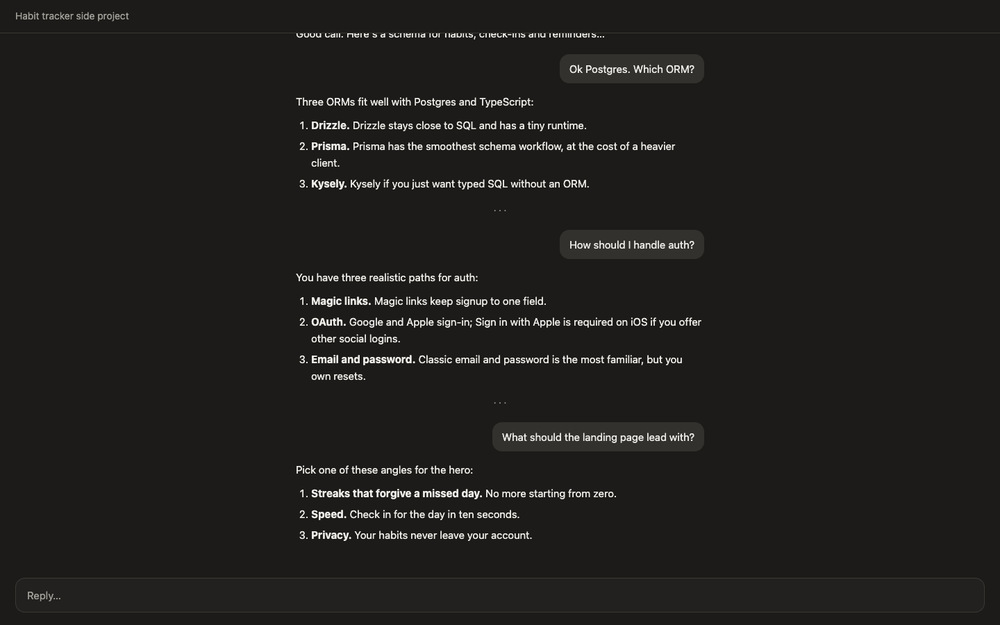

# Forkmap

**A map of the roads not taken in your Claude conversations.**

Forkmap is a skill for the Claude app and Claude Code. Ask *"what other options did we skip?"* and it finds every point where Claude offered several directions and you only followed one, then draws them as a clickable tree: what each option was, whether you took it, parked it or ruled it out, and the exact words to find it again.



## Why

Ask Claude for options and you get five. You pick one and go deep for forty turns. The other four are still there, buried in a reply near the top of the chat, and the only way back is to scroll.

Conversation-tree tools don't help here: they track branches made by editing or regenerating a message. Options listed side by side in a single reply aren't branches, so nothing marks them. Forkmap tracks options and what became of them, not message branches.

## What it does

- **Finds fork points.** A reply offers two or more interchangeable options, and the conversation then narrows to one. Sequential steps, examples and pros-and-cons lists are left out.
- **Tracks status.** Every option is *Active*, *Parked*, *Rejected*, *Later*, or *Pending* (just listed, not chosen yet). Rejected and Later need evidence in the conversation; when in doubt it says Parked.
- **Locates the original.** Each option carries its turn number, the words you used in that turn, and a short verbatim quote you can paste into Cmd/Ctrl+F.
- **Draws a clickable tree.** Nested forks hang under the option they came from. Filter by status, and click a node for details plus buttons to copy the quote or continue that direction.
- **Speaks your language.** The map is written in the language of your conversation. Quotes are never translated, so search still finds them.
- **Keeps names stable.** Titles and fork numbers stay the same across runs, so the map you saw yesterday still makes sense today.

### In Claude Code it also

- **Reads the session transcript from disk**, so quotes stay exact even after the context has been compacted.
- **Saves the map per project** in `.forkmap/`, across sessions: `forkmap.json` (data), `forkmap.html` (clickable tree) and `FORKMAP.md` (text tree).
- **Takes you back.** Every node has a `claude --resume <session>` command that reopens the session it came from.
- **Updates incrementally.** Later runs read only the new turns, keep your numbering, and never overwrite a status you set by hand.

## Install

### Claude app (claude.ai, desktop, mobile)

Skills need a paid plan with **code execution** turned on (Settings → Capabilities).

1. Download `forkmap.zip` from the [latest release](../../releases/latest), or build it yourself (see [Build](#build)).
2. Open **Customize → Skills** and upload the zip.
3. Start a new chat. Skills don't load into chats that are already open.

### Claude Code

Pick one:

- **Through the Claude app.** If Claude Code is signed in with the same account, skills uploaded on claude.ai can sync to Claude Code automatically. A synced copy shows up as `/anthropic-skills:forkmap`.
- **From this repo**, which is handy for hacking on it:

  ```bash
  git clone https://github.com/Code-byte404/forkmap.git
  ln -s "$PWD/forkmap/forkmap" ~/.claude/skills/forkmap
  ```

  Restart `claude` if `/forkmap` doesn't show up. Don't install both ways at once, or you'll have two copies competing for the same requests.

The Claude Code side needs `python3`; no extra packages.

## Use

In any conversation, ask in your own words:

> what other options did we skip?

Any language works. Or call it directly with `/forkmap`. Then keep talking to it:

| Say | What happens |
| --- | --- |
| "mark #1-B as rejected" | Changes the status. Statuses you set by hand win over Claude's guesses. |
| "only show parked ones" | Lists the parked options (the map also has filter chips). |
| "expand #1-B" | Picks that direction back up and marks it Active. |
| "also scan my last session" | Claude Code: merges another session into the project map. |

Run it again later in the same conversation or project and it updates the existing map instead of starting over.

## How it works

The model does the judgment: which replies hold real alternatives, and what happened to each one. Everything else is fixed so the output is consistent and checkable:

- `forkmap/assets/tree.html` is the one page template. Claude fills in a JSON data block and doesn't touch the markup, so every map looks and behaves the same.
- `forkmap/scripts/transcript.py` (Claude Code) turns a session's JSONL transcript into numbered turns. It follows the active branch, skips tool output and injected context, and shows local times.
- `forkmap/scripts/render.py` (Claude Code) writes `forkmap.html` and `FORKMAP.md` from `.forkmap/forkmap.json`.
- UI text defaults to English. For other languages Claude adds a `ui` object with translated labels (keys in [`references/ui-strings.md`](forkmap/references/ui-strings.md)). In Claude Code that object is stored with the map, so the wording stays the same between runs.

```
forkmap/                  the skill, the folder you install
├── SKILL.md              instructions shared by both environments
├── references/
│   ├── claude-code.md    Claude Code workflow: transcripts, storage, incremental runs
│   └── ui-strings.md     translatable UI labels
├── scripts/
│   ├── transcript.py     read Claude Code session transcripts
│   └── render.py         render the stored map to HTML and Markdown
└── assets/
    └── tree.html         the clickable tree template
docs/
├── demo.gif
└── demo/forkmap.json     data behind the demo
build.sh                  package the skill as dist/forkmap.zip
```

## Limitations

- **The Claude app can't jump to a message.** The chat has no per-message links, and the map runs in a sandbox that can't scroll the chat. Instead you copy the quote and search with Cmd/Ctrl+F. In Claude Code, the resume command gets you back to the session.
- **In the app, a map covers the current chat only.** Skills there have no storage that persists across chats.
- **Detection is a judgment call.** Expect the occasional missed or extra fork, especially in very long conversations. Correct it in plain words and the map updates.
- **The Claude Code transcript format is internal** and can change between versions. `transcript.py` is defensive, and the skill falls back to the conversation in context if parsing fails.
- **Separate installs.** Unless your app upload syncs to Claude Code, update the skill in each place yourself.

## Build

```bash
./build.sh   # writes dist/forkmap.zip, ready to upload to the Claude app
```

To preview a map without Claude, run `python3 forkmap/scripts/render.py docs/demo/forkmap.json --open`. This also writes the HTML and Markdown into `docs/demo/`, which is gitignored.

## Contributing

Issues and pull requests are welcome, especially:

- conversations where fork detection got it wrong (share the relevant turns),
- reports of the Claude Code transcript format changing,
- translations that read better than what Claude generates for your language.

## License

[MIT](LICENSE)
